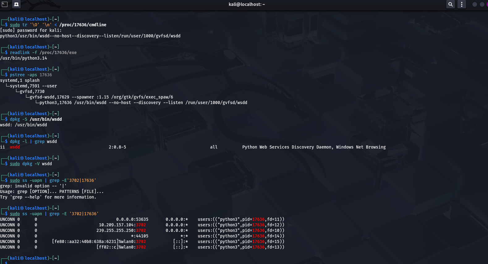
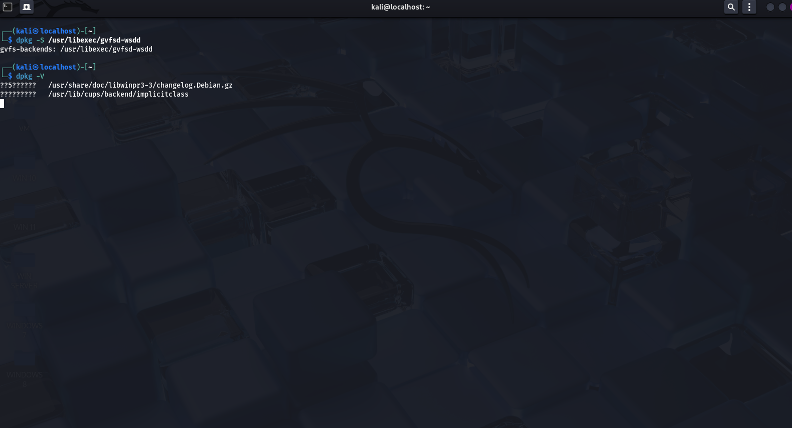
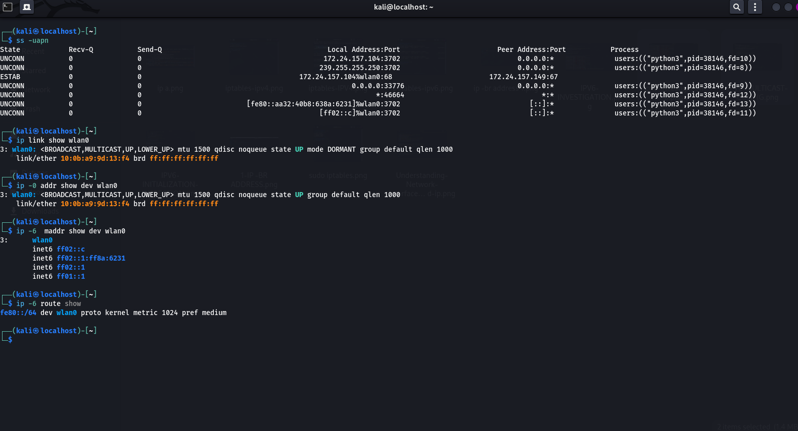
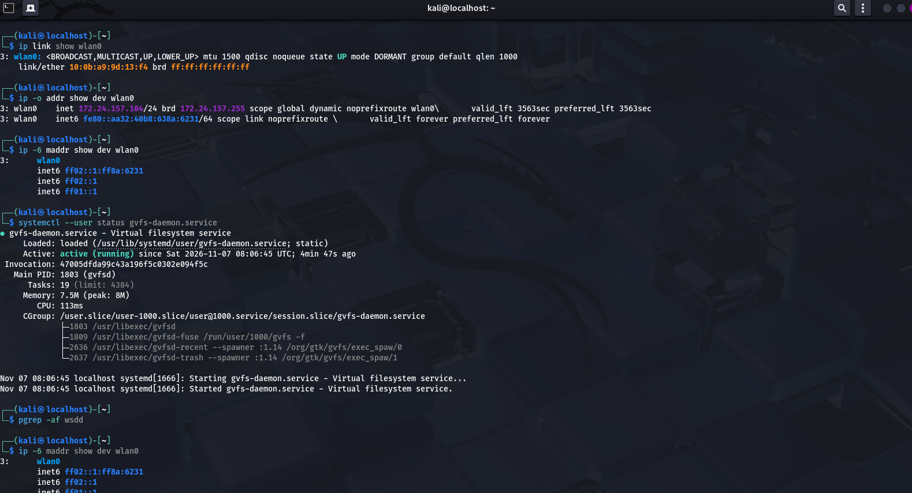
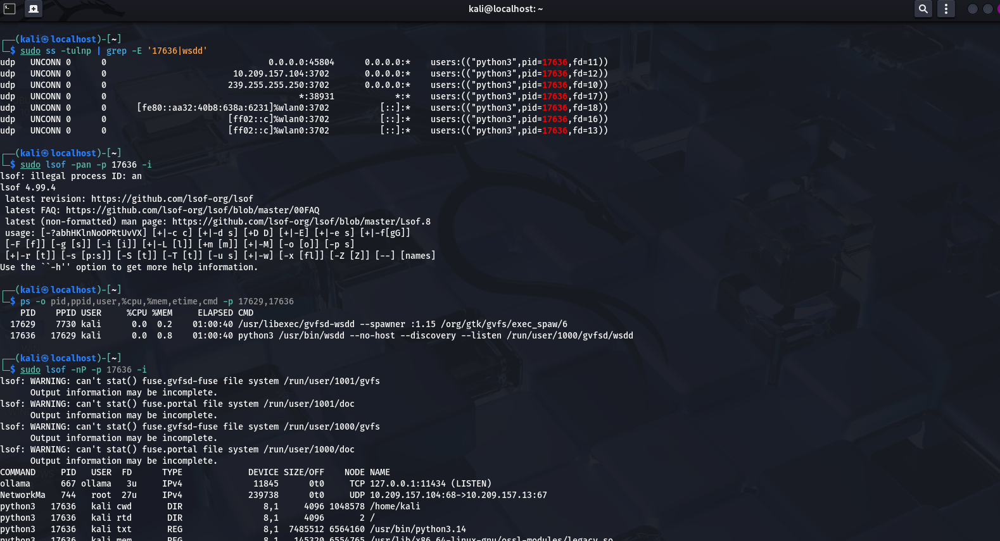
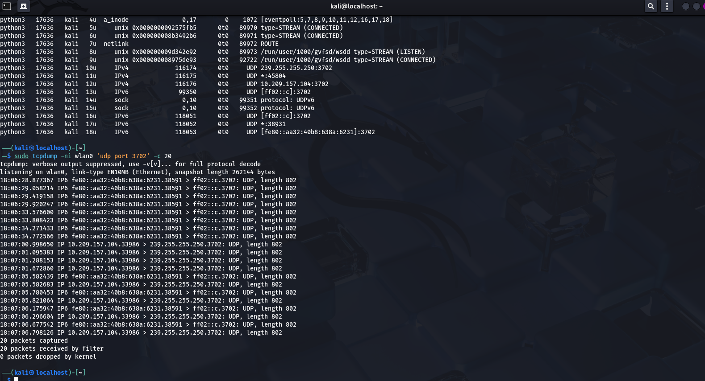
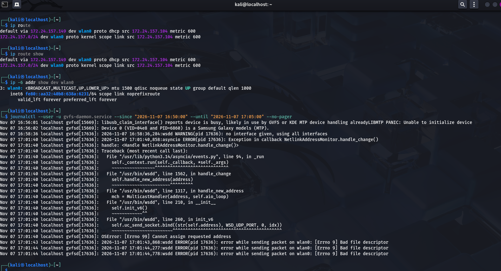
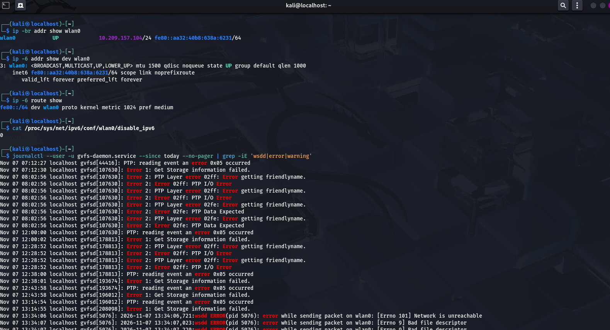
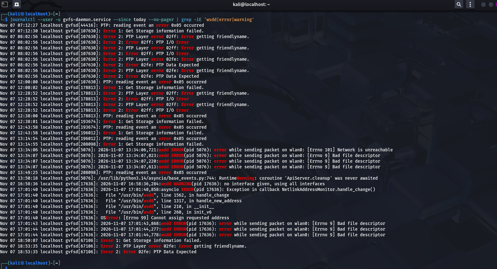

# WSDD Process Investigation Kali Purple operating system

- **Investigation date:** 7 November 2026
- **System:** Kali Purple
- **Status:** CLOSED

## 1. Objective

The purpose of the investigation was to determine whether a running 'wsdd' process on my kali purple operating system (which is Debian-based Linux distribution variant of kali linux, that is preloaded with defensive-security tools for learning and practicing blue-team skills in an isolated homelab), was legitimate or harmful 
when I ran `ss -tulnp` the command that lists every port on the machine that is open and waiting for connection,
I saw two processes that were listening and that was wsdd and ollama. I investigated `wsdd` parent process, installed packages, network
activity , executable location and system logs. The `Ollama` listener (port 11434) was already investigated in [Practical Lab 18:Investigating TCP Connection states](https://github.com/Larrykariuki/NETWORKING-JOURNEY/blob/main/01-Networking%20-%20foundations/20-packet-analysis.md#practical-lab-18-investigating-tcp-connection-states) in my networking-journey repository. It was bound to `127.0.0.1`, the loopback address, so it only accepts connections from the local machine and poses no threat and lowers the exposure however this alone does not prove whether the process itself is legitimate because a malicious program can also bind itself to `127.0.0.1` for instance to relay traffic locally

## 2. Process Identification
The process command was
``` text 
python3 /usr/bin/wsdd
```
The process was launched through the GVfs desktop file-management services as shown in the process tree below
``` text
systemd
|
|___systemd --user
   |
   |___gvfsd
      |
      |____gvfsd-wsdd
          |
          |____python3 /usr/bin/wsdd 
```

## 3. Package Verification
I checked which installed packages owned the relevant files
The commands used:
- dpkg -S/usr/bin/wsdd
- dpkg -S/usr/libexec/gvfsd-wsdd
- dpkg -l | grep -E 'gvfs-backends|wsdd'
- sudo dpkg -V wsdd gvfs-backends
- Both the wsdd and gvfs-backends were installed packages and the package verification produced no output hence indicating that no
   differences were detected and the files are unmodified.




## 4. Network Investigation
WSDD supports Web Services Dynamic Discovery (WS-Discovery) which is a small background service (daemon) and not a kernel module that
handles discovery of windows  computers on the local area network.
The Investigation showed UDP port 3702 and multicast network
The commands used are:
- ss -uapn
- ip link show wlan0
- ip -0 addr show dev wlan0
- ip -6 maddr show dev wlan0
- ip -6 route show
WSDDs network discovery activity was consistent with the purpose it was intended for






## 5. Log Investigation
The journal contained a lot of errors:
- Errno 101: Network is unreachable 
- Errno 99: Cannot assign requested address
- Errno 9: Bad file descriptor
- The IPV6 traceback showed WSDD attempting to bind a UDP socket while processing a network address change.
- The evidence available shows a network interface or address transition issue and I could not establish the
exact triggering event, many GVfs PTP errors were also observed but were not identified as wsdd errors





## 6. Findings 
- WSDD was owned by an installed Debian package
- Its executable passed package verificartion
- Its parent process was associated with GVfs
- Its network activity was consistent with WS-Discovery
- The observed errors were not sufficient enough to establish malicious activity
- WSDD was not running during a later process check


## 7. Conclusion
Investigation result: No indicators of compromise were seen or identified within the scope of the invectigation
The IPV6 socket initialization failure remains unexplained at the triggering-event level 
But this conclusion does not necessarily establish that the entire system is free from malware or other issues of security

## 8. Skills Practiced
- Linux process investigation 
- Process tree analysis
- Debian package verification 
- Network socket inspections
- IPV4 and IPV6 multicast investigation
- system journal analysis 
- Basic Security incident documentation
